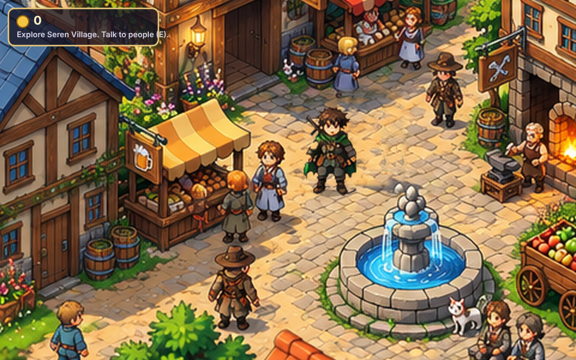

# RPG Dream

Top-down anime JRPG village prototype. Pure HTML5 canvas + vanilla JavaScript, walang build step.



## Paano patakbuhin

- **Pinakasimple:** i-double-click ang `index.html` (gumagana sa Chrome/Edge/Firefox).
- **O via local server:** `npm start` tapos buksan ang http://localhost:8080

## Controls

| Action | Keyboard | Touch |
| --- | --- | --- |
| Move | Arrow keys / WASD | D-pad (left) |
| Talk / Confirm | E, Space, Enter | A button (right) |

## Ano ang nasa laro

- Painted village map (Seren Village) na may fountain, stalls, inn, blacksmith.
- Hero na naglalakad, collision sa buildings, fountain, at mga tao.
- Dialogue system na may portrait at typewriter text.
- Isang quest: hanapin si Mochi (pusa) para kay Mira (innkeeper). Reward: 20 gold.

## Structure

```
index.html          entry point
src/world.js        map data: walkable area, NPCs, dialogue, quest logic
src/game.js         engine: input, movement, collision, camera, render, HUD
assets/map.png      village backdrop (2x)
assets/hero.png     player sprite (2x)
tools/screenshot.mjs  smoke test (Playwright): load, move, collide, talk
docs/               screenshots + guides
```

## Test

```
npm install        # one time (Playwright)
npm test           # runs the smoke test, writes screenshots to docs/
```

Tingnan ang `docs/ASSET_GUIDE.md` para sa paggawa ng bagong art (map, characters) sa parehong style.
